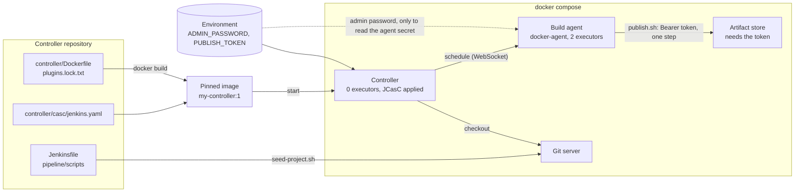

# Architecture: a controller that is only code

This document describes what is in this repository and why it is shaped this way. Component names match the diagram in the lesson ("A controller that is only code"): **Controller repository**, **Pinned image**, **Controller**, **Build agent**, **Project Jenkinsfile** and **Deploy token**.

## Components and what each owns

| Component | Where it lives | What it owns |
| --- | --- | --- |
| **Controller repository** | this repository | Everything that defines the controller: [`controller/`](controller), [`agent/`](agent), [`docker-compose.yml`](docker-compose.yml), the [`Jenkinsfile`](Jenkinsfile) and the project it builds ([`app/`](app)). |
| **Pinned image** | [`controller/Dockerfile`](controller/Dockerfile), built as `my-controller:1` | A Jenkins LTS image pinned by tag *and* digest, the 80 plugins of [`plugins.lock.txt`](controller/plugins.lock.txt) at exact versions, the setup wizard turned off, and the configuration file copied to a path outside `JENKINS_HOME`. |
| **Controller** | the `controller` service | Runs configuration as code at start: the local admin user, no anonymous access, **zero executors** on the built-in node, the `docker-agent` node, the `publish-token` credential and the `order-summary` job. Runs no builds. |
| **Build agent** | [`agent/`](agent), the `agent` service | The official inbound agent (JDK 21, git) plus an entrypoint that reads its own connection secret from the controller. Runs the Maven build. Has no access to the controller's home. |
| **Project Jenkinsfile** | [`Jenkinsfile`](Jenkinsfile), plus the scripts in [`pipeline/scripts`](pipeline/scripts) | The pipeline as code: lint, build, parallel tests with their own reports, coverage, an optional approval, publish. |
| **Deploy token** | the `PUBLISH_TOKEN` environment variable of the controller | A Jenkins credential created from the environment; bound to the publish step alone. |
| **Git server** | [`services/git-server`](services/git-server) | Holds a snapshot of this repository (`scripts/seed-project.sh`), which is what the job checks out. |
| **Artifact store** | [`services/publish-sink`](services/publish-sink) | Accepts `PUT /artifacts/<name>` only with the right bearer token; the proof that the credential reached the one step that needs it. |
| **order-summary** | [`app/`](app) | The Java project the pipeline builds: a CSV of orders summarized per customer. Layered, typed, tested. |
| **Tests** | [`tests/`](tests) | Unit tests of the scripts, the store, the configuration and the Jenkinsfile; stack tests that drive Jenkins through its API. |

## The project the pipeline builds

`order-summary` follows the standard Java layering, enforced by an ArchUnit test: `domain` (records `Money`, `Order`, `CustomerSummary`, an enum `OrderStatus`, a named `InvalidOrderException`) depends on nothing; `application` (`SummarizeOrders`, the `OrderSource` port) depends on domain; `infrastructure` (`CsvOrderSource`) implements the port; `interfaces` (`Main`) wires them and owns the exit codes; nothing depends on `interfaces`. Unit tests (`*Test`, Surefire) cover domain and application with an in-memory source; integration tests (`*IT`, Failsafe) run the adapter and the command line over real files. Checkstyle and `-Xlint:all -Werror` are the linters; a JaCoCo rule requires 95 percent line coverage of domain and application.

## Pattern: configuration as code, with an agent that is only a pod-shaped function

The controller is a function of four files and one environment ([ADR 0001](docs/adr/0001-controller-defined-by-files.md)): nothing in its volume is needed to rebuild it. The agent is disposable the same way ([ADR 0002](docs/adr/0002-an-agent-that-fetches-its-own-secret.md)). The pipeline separates *where it waits* from *where it runs* ([ADR 0004](docs/adr/0004-approval-outside-any-agent.md)).

## Data flow

### One run, step by step (`make run`)

1. `docker compose up --build --wait` builds the controller image from the pinned files and starts it. JCasC creates the admin user, the agent node, the credential and the job; the setup wizard never runs. The agent's entrypoint polls `/computer/docker-agent/jenkins-agent.jnlp` with the admin credentials, reads the secret, unsets the password and connects over a WebSocket.
2. `scripts/seed-project.sh` pushes a snapshot of the repository to the Git server. The first build is triggered with no parameters (it registers the Jenkinsfile's parameters).
3. **Verify** runs on `docker-agent`: `checkstyle:check`, then `package -DskipTests`, then the **Test** stage with two parallel branches. Unit runs `jacoco:prepare-agent surefire:test`, Integration runs `failsafe:integration-test failsafe:verify`; each publishes its own JUnit report from a `post { always }` block. **Coverage** checks the JaCoCo data file exists and enforces the threshold. On success the jar is stashed and a summary of both report directories is printed.
4. **Approve** (only with `REQUIRE_APPROVAL=true`) runs with `agent none`: the build waits for `input` and holds no executor. The test posts the approval through the API.
5. **Publish** unstashes the jar on an agent and binds `publish-token` around `pipeline/scripts/publish.sh`, which puts the token in a request header read from standard input and uploads the jar. With `ECHO_TOKEN=true` the step also echoes the token to show that the log masks it. `archiveArtifacts` runs from the stage's `post { success }` block only.

## Decisions and trade-offs

**Files define the controller; the volume holds only history.** [ADR 0001](docs/adr/0001-controller-defined-by-files.md). The cost is a lock file to regenerate (`make plugins-lock`) and a rebuild that takes minutes.

**An agent that fetches its secret.** [ADR 0002](docs/adr/0002-an-agent-that-fetches-its-own-secret.md). The agent container briefly holds the admin password.

**Maven, with the wrapper.** [ADR 0003](docs/adr/0003-maven-wrapper-for-the-project.md). The lesson's sample uses Gradle; any build tool fits the pipeline's shape.

**`agent none` and an approval with no agent.** [ADR 0004](docs/adr/0004-approval-outside-any-agent.md). The jar crosses the two agent allocations by `stash`.

**The token goes in a header read from standard input.** `curl -H "Authorization: Bearer $TOKEN"` would put the token in the agent's process list; `--header @-` does not. Jenkins's masking protects the log; this protects the machine.

**Test failures fail the build.** `sh ./mvnw ...` exits non-zero, so the stage fails and the build is red, not yellow; the report is still published because it is in `post`, and nothing is archived because archiving is in `post { success }`.

**`disableConcurrentBuilds` and a 20-minute timeout.** A hung build is cut off; two runs of one job cannot fight over the Maven cache.

## Failure modes the lesson teaches, and how the code shows them

| Failure | What you see | How to reproduce |
| --- | --- | --- |
| **The container and volume are destroyed** | The same controller returns: same configuration export, same plugins | `make rebuild-proof` |
| **A plugin installed by hand** | Would vanish on rebuild; the stack test compares the running list with the lock file | `tests/stack/test_controller.py` |
| **A failing test** | Red build, the report with the failure, no artifact, no publish | run with `BREAK_A_TEST=true` (in `make run`) |
| **A build landing on the controller** | Impossible by configuration: zero executors, and the console shows `Running on docker-agent` | `tests/stack/test_pipeline.py` |
| **A token in the log** | Masked as `****` even when a step echoes it | run with `ECHO_TOKEN=true` |
| **An approval that holds an executor** | The agent shows no running executable while the build waits | run with `REQUIRE_APPROVAL=true` |
| **A pinned image that moves** | Cannot: tag and digest are both in the Dockerfile | `tests/unit/test_controller_config.py` |

## Limits of the teaching build against production

- **One controller, one agent, no high availability.** Production runs agents on a cluster, scaled out (the third Jenkins project), and backs up what configuration as code cannot recreate: build history and the secrets that are not in the environment.
- **Local accounts.** Production uses an identity provider and group-based roles.
- **The agent receives the admin password to read its secret.** A dedicated, narrowly scoped token fixes that.
- **HTTP on loopback ports.** Production puts TLS in front of everything.
- **The Git server has no authentication.** The job's repository is a snapshot of this one, not a pull-request workflow.
- **The artifact store is a stand-in** for Nexus, Artifactory or a registry; it exists to prove where the token goes.

## How to extend it

- **A multibranch pipeline:** replace the job's `pipelineJob` with `multibranchPipelineJob` in `controller/casc/jenkins.yaml` and point it at the Git server.
- **A cloud agent template:** add a `clouds:` block (the Kubernetes plugin) to the casc file and the plugin to `plugins.txt`; the third Jenkins project does this.
- **A shared library:** move `pipeline/scripts` behind `vars/` steps; the second Jenkins project does this.
- **Back up only what casc cannot recreate:** `JENKINS_HOME/jobs/*/builds` and `secrets/`. Everything else is in this repository.
